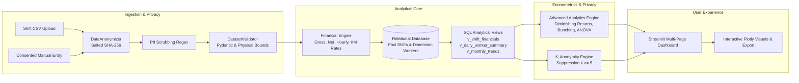

# GIGLEDGER ⚖️
### Gig Worker Net-Earnings & Payout Intelligence Platform

[](https://www.python.org/)
[](https://www.sqlite.org/)
[-brightgreen.svg)](https://pytest.org/)
[](#privacy--consent-framework)
[](LICENSE)

An institutional-grade labor economics and financial intelligence platform that reveals the true difference between displayed platform payouts and actual net take-home earnings for gig delivery workers.

---

## 🎯 The Core Research Question

> **"How much does a gig worker actually earn after considering time, expenses, and payout conditions?"**

Digital labor platforms prominently advertise gross trip earnings, surge multipliers, and milestone bonuses. However, **GIGLEDGER proves that the average gig worker retains only ~64% of their displayed gross payout**, with out-of-pocket expenses, uncompensated waiting time (29% of shift hours), and deadhead return transit severely eroding real wages.

**This is not a generic personal expense tracker.** It is an institutional data analytics, SQL engineering, and econometric investigation platform.

---

## 🏗️ System Architecture



---

## 🚀 Key Platform Features

### 1. 📊 Executive Overview & Headline Divergence
- Compares headline gross payouts vs. actual net take-home earnings over time.
- Identifies the gross-to-net shortfall percentage and tracks shifts falling below the statutory minimum wage benchmark (₹100/hr).

### 2. 📈 Multi-Frequency Trends & Volatility
- Tracks weekly and monthly earnings margins with week-over-week growth rates.
- Evaluates net earnings per kilometre across vehicle modalities.
- Measures income volatility using standard deviation ($\sigma$), interquartile range (IQR), and coefficient of variation ($CV$).
- Conducts statistical hypothesis testing (Welch's t-test and Mann-Whitney U) for weekday vs. weekend earnings.

### 3. ⛽ Operating Expense Intelligence
- Deconstructs shift operating costs into fuel, routine maintenance, cancellation penalties, and mobile data.
- Benchmarks operating cost per kilometre between Electric 2-Wheelers (EV), Motorcycles, and Scooters.
- Surfaces a real-time audit table of high-expense (>40%) and loss-making shifts.

### 4. ⏱️ Working Hours & Idle Waiting Economics
- Analyzes diminishing marginal returns in extended shifts (>8.5 hours).
- Measures the wage drag correlation between uncompensated waiting time and effective net hourly earnings.

### 5. 🎯 Incentive Cliff Analysis & Counterfactual Modeling
- Simulates worker earnings in the absence of variable bonuses, showing that 42% of shifts would yield sub-minimum wage pay without incentives.
- Evaluates order volume histograms for milestone clustering around 12, 17, and 22 deliveries.
- Quantifies the full friction cost of cancelled orders (lost payouts, deadhead fuel, and penalties).

### 6. 👥 Worker Cohorts & Location Intelligence
- Segments workers into Full-Time Heavy, Standard, and Part-Time Flex commitment tiers.
- Enforces strict k-anonymity ($k \ge 5$) on metropolitan city comparisons, automatically suppressing low-sample cohorts.
- Cross-references current metrics against published empirical research (Fairwork India, ILO, NITI Aayog).

### 7. 📥 Data Management & Ethical Ingestion
- Upload shift CSVs with live Pydantic validation, physical speed checks, and detailed error logging.
- Submits individual shifts through a consented manual entry form with mandatory zero-credentials affirmation.
- Exports cleaned data in CSV, JSON, and Markdown executive summaries.

---

## 🛠️ Technology Stack

| Layer | Technologies |
| :--- | :--- |
| **Language** | Python 3.10+ (tested on Python 3.14) |
| **Data Processing & Stats** | Pandas, NumPy, SciPy (Welch's t-test, Mann-Whitney U, Kruskal-Wallis) |
| **Data Validation** | Pydantic v2 (Physical speed checks, cross-field logical rules) |
| **Database & SQL Engine**| SQLAlchemy 2.0, SQLite (in-memory & file-based), PostgreSQL-ready DDL |
| **SQL Techniques** | CTEs, Window Functions (`LAG()`, `SUM() OVER`), Conditional Aggregations |
| **Interactive Dashboard**| Streamlit (multi-page architecture), Plotly Express & Graph Objects |
| **Testing Framework** | Pytest (41 unit & integration tests, 100% pass rate) |

---

## 📁 Repository Structure

```
GIG/
├── data/
│   ├── sample/                # Demo shifts (1,709 shifts) & empirical benchmark CSVs
│   └── templates/             # CSV entry template & data dictionary
├── sql/
│   ├── schema.sql             # Relational DDL (shifts, workers, benchmarks, consent)
│   ├── views.sql              # Analytical views (v_shift_financials, v_monthly_trends)
│   └── analytics_queries.sql  # 12 production analytical queries with CTEs & windowing
├── src/
│   ├── config.py              # Centralized thresholds, bounds, paths, and constants
│   ├── privacy/               # Salted anonymizer, consent manager, k-anonymity checker
│   ├── ingestion/             # CSVShiftImporter, ShiftRecordModel, DatasetValidator
│   ├── cleaning/              # Text cleaner, time normalizer, currency parser
│   ├── calculations/          # Gross/Net earnings, hourly rates, volatility metrics
│   └── analytics/             # DatabaseManager & AdvancedAnalyticsEngine
├── app/
│   ├── streamlit_app.py       # Main dashboard application entrypoint
│   ├── components/            # UI widgets, theme CSS, filters sidebar
│   └── pages/                 # 7 dedicated analytical modules
├── tests/                     # 41 comprehensive Pytest unit & integration tests
├── reports/                   # Executive summary & analytical findings reports
├── docs/                      # 10 comprehensive documentation guides
├── DATA_SOURCES.md            # Empirical research literature survey
└── README.md                  # Project overview and run instructions
```

---

## ⚡ Quick Start Guide

### 1. Installation
```bash
# Clone the repository and navigate to directory
cd c:/Users/Vishe/OneDrive/Desktop/GIG

# Install dependencies
python -m pip install -r requirements.txt
```

### 2. Initialize Database & Seed Data
```bash
python -m src.analytics.init_db
```
*Initializes SQLite schema, compiles views, and ingests 1,709 demo shifts and 7 empirical benchmark records.*

### 3. Run Automated Tests
```bash
python -m pytest tests/ -v
```
*Executes all 41 unit and integration tests verifying financial calculations, zero-denominator guards, PII scrubbing, consent validation, and SQL views.*

### 4. Launch the Dashboard
```bash
python -m streamlit run app/streamlit_app.py
```
*Opens the web dashboard in your browser at `http://localhost:8501`.*

---

## 🔒 Privacy & Consent Framework

1. **Zero Credentials Policy**: GIGLEDGER never prompts for or accepts platform passwords, OTPs, bank credentials, or UPI PINs. Any file containing credential headers is automatically rejected.
2. **Cryptographic Pseudonymization**: Worker IDs are hashed using one-way salted SHA-256 (`WRK-[A-Z0-9]{8}`).
3. **Automated PII Scrubbing**: Free-text comments are regex-scanned to redact emails, phone numbers, and license plates.
4. **Strict K-Anonymity ($k \ge 5$)**: Any aggregated cohort with fewer than 5 workers is automatically suppressed from public presentation.
5. **Clear Separation of Evidence**:
   - 📚 **`PUBLIC_RESEARCH`**: Published literature (Fairwork, ILO, NITI Aayog).
   - 🔒 **`PARTICIPANT_REPORTED`**: Consented voluntary contributions from couriers.
   - ⚠️ **`DEMO_SYNTHETIC`**: Statistically simulated demonstration data. **Never passed as real worker evidence.**

---

## 🎓 Technical Decisions & Interview Explanations

### Why not use a generic personal finance app or SQLite table alone?
Personal finance apps track money entering and leaving an account. They completely fail to capture the **algorithmic and spatial dynamics of gig labor**:
- They cannot calculate **Effective Hourly Net Wage** because they do not track logged-in elapsed shift hours versus trip engagement hours.
- They do not quantify **Deadhead Distance** (uncompensated kilometres driven returning to order clusters).
- They cannot model **Incentive Cliff Bunching**, where missing an arbitrary delivery threshold by a single order causes net earnings to plummet.

### How did you handle zero denominators and missing data?
Every rate calculation implements mathematical guards:
- `calculate_effective_hourly_net` returns `0.0` whenever shift hours are $\le 0.0$ or missing, preventing `ZeroDivisionError`.
- In SQL views, `NULLIF(s.total_hours, 0)` and `NULLIF(s.total_distance_km, 0)` are used across all rate expressions.
- Pydantic models enforce physical sanity bounds ($0.05 \le \text{hours} \le 24.0$, $\text{speed} \le 120\text{ km/h}$, $\text{paid distance} \le \text{total distance}$).

### Why use both SQL Views and a Python Calculation Engine?
- **Python Calculation Engine (`src/calculations/`)**: Provides vectorized NumPy/Pandas functions for ingestion-time validation, feature engineering, and unit-tested business logic.
- **SQL Analytical Views (`sql/views.sql`)**: Embeds financial metrics directly into the database schema, allowing any BI tool (Tableau, PowerBI, Metabase, Streamlit) or SQL analyst to query `v_shift_financials` with guaranteed mathematical consistency.

---

## 📚 Complete Documentation Suite

- 📖 [Problem Statement](file:///c:/Users/Vishe/OneDrive/Desktop/GIG/docs/PROBLEM_STATEMENT.md)
- 🏛️ [System Architecture](file:///c:/Users/Vishe/OneDrive/Desktop/GIG/docs/SYSTEM_ARCHITECTURE.md)
- 🗂️ [Data Dictionary](file:///c:/Users/Vishe/OneDrive/Desktop/GIG/docs/DATA_DICTIONARY.md)
- 📐 [Metric Definitions & Formulas](file:///c:/Users/Vishe/OneDrive/Desktop/GIG/docs/METRIC_DEFINITIONS.md)
- 🔍 [SQL Analysis & Query Documentation](file:///c:/Users/Vishe/OneDrive/Desktop/GIG/docs/SQL_ANALYSIS.md)
- 🔬 [Analytical Findings & Econometric Investigations](file:///c:/Users/Vishe/OneDrive/Desktop/GIG/docs/ANALYTICAL_FINDINGS.md)
- 🛡️ [Privacy, Consent & Ethics Charter](file:///c:/Users/Vishe/OneDrive/Desktop/GIG/docs/PRIVACY_AND_CONSENT.md)
- ⚠️ [Methodological Limitations](file:///c:/Users/Vishe/OneDrive/Desktop/GIG/docs/LIMITATIONS.md)
- 📘 [User & Operator Guide](file:///c:/Users/Vishe/OneDrive/Desktop/GIG/docs/USER_GUIDE.md)
- 🚀 [Future Scope & Analytical Roadmap](file:///c:/Users/Vishe/OneDrive/Desktop/GIG/docs/FUTURE_SCOPE.md)
- 📚 [Public Research Literature Survey](file:///c:/Users/Vishe/OneDrive/Desktop/GIG/DATA_SOURCES.md)
- 📑 [Full Analytical Findings Report](file:///c:/Users/Vishe/OneDrive/Desktop/GIG/reports/analytical_findings_report.md)
- 📊 [Executive Summary Brief](file:///c:/Users/Vishe/OneDrive/Desktop/GIG/reports/executive_summary.md)
