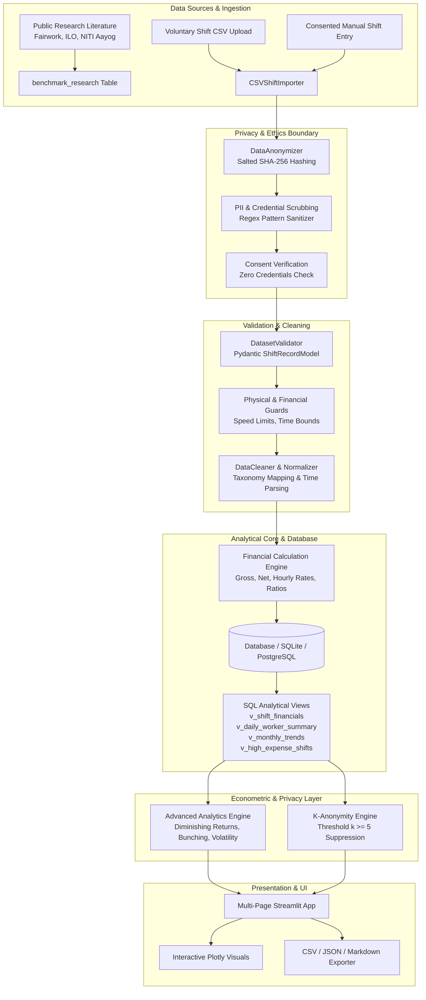

# GIGLEDGER — System Architecture



---

## 1. Architectural Principles

GIGLEDGER is designed following four core software engineering and data science principles:

1. **Separation of Concerns**: Distinct separation between data ingestion, cryptographic anonymization, schema validation, financial rate calculation, database storage, and presentation.
2. **Immutable Auditability**: All raw inputs are checked against schema rules before entering the database, while data origins (`PUBLIC_RESEARCH`, `PARTICIPANT_REPORTED`, `DEMO_SYNTHETIC`) are strictly tracked on every record.
3. **Privacy-by-Design**: Salted hashing occurs before data touches relational storage. No raw user handles, phone numbers, or vehicle plates ever persist in the database.
4. **Resilient Vectorized Calculations**: Rate metrics are computed using vectorized Pandas and SQL views with division-by-zero guards, NaN coercions, and physical limits.

---

## 2. Directory & Module Breakdown

```
GIG/
├── data/
│   ├── sample/                # Demo shifts & empirical benchmark CSVs
│   └── templates/             # Reusable CSV template & data dictionary
├── sql/
│   ├── schema.sql             # DDL table creation (SQLite / PostgreSQL)
│   ├── views.sql              # Analytical views with derived financial metrics
│   └── analytics_queries.sql  # 12 documented production CTE & window queries
├── src/
│   ├── config.py              # Centralized thresholds, bounds, and paths
│   ├── privacy/               # Anonymizer, ConsentManager, KAnonymityChecker
│   ├── ingestion/             # Importer, ShiftRecordModel, DatasetValidator
│   ├── cleaning/              # Text cleaner, time normalizer, currency sanitizer
│   ├── calculations/          # Gross/Net earnings, hourly rates, volatility
│   └── analytics/             # DatabaseManager & AdvancedAnalyticsEngine
├── app/
│   ├── streamlit_app.py       # Main dashboard application entrypoint
│   ├── components/            # UI widgets, theme CSS, filters sidebar
│   └── pages/                 # 7 dedicated analytical pages
├── tests/                     # 41 unit & integration tests (Pytest)
├── reports/                   # Executive summaries and research reports
├── docs/                      # 10 comprehensive documentation guides
├── DATA_SOURCES.md            # Empirical literature documentation
└── README.md                  # Project overview and run instructions
```

---

## 3. Database & SQL Architecture

The platform uses a hybrid relational schema optimized for both single-shift transactional fidelity and fast analytical aggregations.

### Core Tables
1. **`workers`**: Dimension table storing pseudonymous worker identifiers, modality, city, and consent confirmation.
2. **`shifts`**: Fact table recording shift operational volumes (hours, distance, orders, wait time) and financial flows (base pay, incentives, fuel, maintenance, penalties).
3. **`benchmark_research`**: Historical reference dataset from published empirical literature.
4. **`consent_records`**: Ethical audit log recording versioned consent affirmations.

### Analytical Views
- **`v_shift_financials`**: Computes `gross_earnings`, `total_expenses`, `net_earnings`, `effective_hourly_net`, `net_earnings_per_km`, `expense_ratio`, `incentive_dependency`, and `unpaid_time_ratio` for every individual shift.
- **`v_daily_worker_summary`**: Aggregates shift totals per worker per calendar day.
- **`v_monthly_trends`**: Calculates platform-wide monthly macro trends, active worker counts, and expense margins.
- **`v_high_expense_shifts`**: Surfaces shifts where expense burden exceeded 40% or net earnings were zero/negative.
